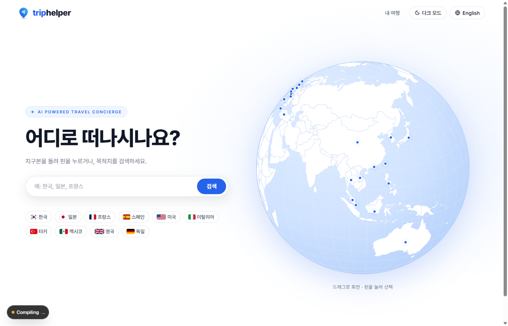
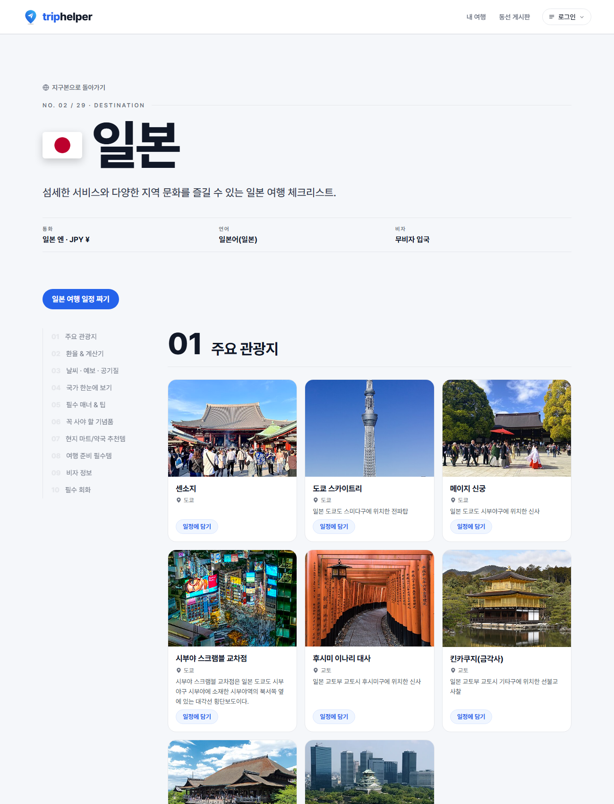
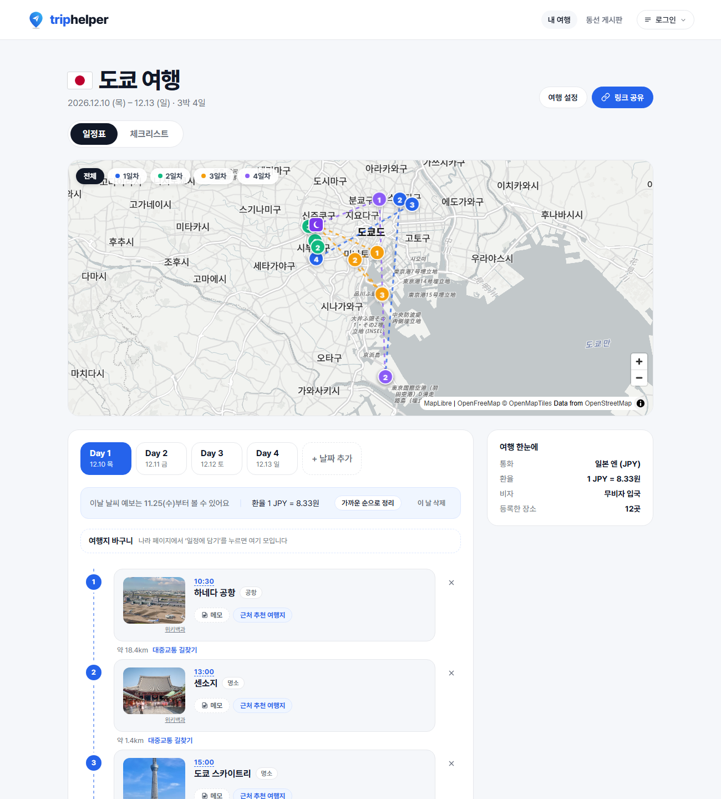

<div align="center">


# TripHelper

### 해외여행 정보 통합 플랫폼 | Travel Information Hub

**목적지 하나만 고르면, 여행 준비에 필요한 정보와 내 일정까지 한 곳에서**

[](https://jhkr1.github.io/triphelper/)
[](https://nextjs.org)
[](https://react.dev)
[](https://www.typescriptlang.org)

</div>

---

## 프로젝트 배경 및 문제 정의

### 스크린샷

<details>
<summary>메인 페이지 (지구본)</summary>

</details>
<details>
<summary>나라 정보 페이지 (주요 관광지)</summary>

</details>
<details>
<summary>내 여행 플래너 (지도 동선 · 장소 간 이동 · 가까운 순으로 정리)</summary>

</details>

<br/>

해외여행을 다녀온 뒤, **정보의 파편화** 문제를 직접 경험했습니다.

> 여행 준비를 위해 환율은 네이버, 날씨는 기상 앱, 현지 매너는 블로그, 회화는 번역기, 비자 정보는 외교부 사이트…
> 평균적으로 **5~7개의 서비스**를 오가며 정보를 수집해야 했고, 이 과정에서 정보의 신뢰도와 최신성도 보장되지 않았습니다.

**TripHelper**는 이 문제를 해결하기 위해 시작했습니다.
여행 준비에 필요한 핵심 정보(환율·날씨·매너·회화·비자 등)를 한 페이지에 모으고,
그 정보를 바탕으로 **날짜별 일정을 지도 위에서 짜는 플래너**와, 다른 여행자의 동선을 보고 가져오는 **동선 게시판**까지 연결했습니다.

---

## 수치로 보는 프로젝트

| 지표 | 수치 |
|------|------|
| **지원 국가** | 38개 나라·지역 (아시아 17, 유럽 14, 아메리카 3, 오세아니아 4) |
| **나라 페이지** | 국가당 최대 10개 섹션 · 빌드 시 38개 페이지를 정적 HTML로 생성 |
| **주요 관광지** | 300곳 (사진·좌표·한국어 설명 포함) |
| **회화 표현** | 나라별 현지어 표현 (발음 + 음성 재생) |
| **지원 언어** | 한국어 |
| **환율 추이** | 최근 7일 일별 데이터 병렬 수집 |
| **날씨** | 실시간 + 5일 예보(나라 페이지) / 최대 16일 예보(플래너 날짜별) |
| **연동 외부 서비스** | 정보·지도는 모두 무료·API 키 불필요 (환율, 날씨·공기질, 위키백과·위키데이터, OpenStreetMap 검색, 벡터 지도) |
| **서버·DB** | 상시 서버 없음 — 정적 사이트(GitHub Pages) + 브라우저에서 바로 쓰는 Supabase(로그인 · 일정 저장 · 게시판) + 구글 지도 짧은 링크를 푸는 Edge Function 하나 |

---

## 주요 기능

### 지구본으로 여행지 고르기
- D3 직교 투영 지구본: 드래그로 회전, 핀을 누르면 그 나라로 회전한 뒤 나라 페이지로 이동
- 검색창, 인기 여행지 칩

### 나라 정보 페이지 (`/destinations/japan/` 등)
- **주요 관광지**: 사진 카드 + "일정에 담기" 버튼으로 내 여행에 바로 추가
- **실시간 환율 + 계산기 + 7일 추이 차트** (Canvas로 직접 구현)
- **날씨 · 5일 예보 · 공기질** (PM2.5 · UV · AQI)
- 국가 한눈에 보기, 필수 매너 & 팁, 기념품, 마트·약국 추천템, 여행 준비 필수템, 비자 정보
- **필수 회화 + 음성 재생** (Web Speech API, 나라별 언어 코드로 발음)
- 스크롤을 따라오는 목차, 현재 읽는 섹션 표시

### 내 여행 플래너 (`/trip/`)
- **여행 설정**: 나라 · 도시(자유 입력, 실제 도시인지 확인) · 날짜, 날짜 추가/삭제
- **일정표 + 지도**: 일차별 색 번호 마커와 경로, 지명 한국어 표시, 마우스 휠 확대
- **장소 추가**: 이름만 입력하면 위치를 자동으로 찾아 지도에 표시 (후보가 여럿이면 선택, 못 찾으면 지도에서 직접 지정)
- **구글 지도 링크로 위치 지정**: 검색에 안 나오는 작은 호텔·식당은 구글 지도 링크 · 좌표 · 플러스 코드를 붙여 넣으면 그 자리로 (휴대폰 [공유]의 짧은 링크 `maps.app.goo.gl`도 지원)
- **여행지 바구니 · 끌어서 옮기기**: 나라 페이지에서 담은 관광지를 원하는 날·자리에 끌어다 놓기, Day 탭을 끌어 날짜별 일정 순서 바꾸기
- **숙소**: 날짜별 밤 숙소를 정하면 다음 날 아침 출발지·그날 마지막 도착지로 이어서 표시, 체크인·체크아웃·짐 보관 메모
- **가까운 순으로 정리**: 숙소에서 출발해 숙소로 돌아오는 하루 동선을 이동 거리가 가장 짧게 다시 짜서, 미리 보여 준 뒤 적용 (식당·공항·교통 일정은 제자리 유지)
- **장소 사이 이동**: 가까우면 도보 시간, 멀면 거리 + 대중교통 길찾기(한국은 카카오맵, 해외는 구글 지도로 연결)
- **근처 추천**: 담은 장소 반경 1km의 유명한 곳을 사진과 도보 거리로 추천
- **날짜별 날씨 예보 · 환율**, 관광지 사진
- **가방별 체크리스트**: 나라별 필수템으로 기본 목록, 비 예보가 있으면 우산 등 제안
- **링크 공유**: 일정 전체를 압축해 주소 안에 담아 공유 (받는 사람은 로그인 없이 열람)
- **내 일정 저장**: 로그인하면 일정이 자동으로 저장되고 여러 기기에서 이어서 편집 (주소 `/trip/?id=…`로 새로 고침·즐겨찾기에도 같은 일정)
- **함께 짜는 일정**: 초대 링크로 멤버 초대, 편집/보기 권한, 다른 멤버의 수정이 실시간 반영(장소 단위로 합치기)
- **되돌리기 · 다시 하기**: 장소·숙소·날짜를 빼거나 옮기면 알림의 [되돌리기], 그 밖의 모든 수정은 Ctrl+Z / Ctrl+Shift+Z
- **일정 기록**: 최근 활동에 누가 무엇을 바꿨는지 남고, [이때 보기]로 예전 일정을 본 뒤 그 시점으로 되돌리기. '뺀 장소' 탭에서 지운 장소를 원래 자리로 다시 넣기 (작업 10묶음 보관)

### 내 여행 목록 (`/trips/`)
- 상단 [내 여행]을 누르면 여행이 2개 이상일 때 목록부터 (하나뿐이면 플래너로 바로)
- **이어서 짜기**: 마지막으로 고친 여행을 D-day · 날짜별 장소 수 · 함께 짜는 사람과 함께 크게
- 나머지는 다가오는 여행 · 날짜를 아직 안 정한 여행 · 지난 여행으로 나누고, 복제 · 삭제(함께 짜는 일정은 나가기)

### 동선 게시판 (`/board/`)
- 내 일정을 사본으로 올려 나라별 여행 동선 공유 (전체 공개 / 링크가 있는 사람만)
- 지도 동선 미리보기, 댓글, 마음에 드는 동선을 내 일정으로 가져오기

### 공통
- 카카오 로그인, 반응형, 선 아이콘(이모지 미사용)
- **사용법(?) 버튼**: 화면 구석에 떠 있고 끌어서 네 귀퉁이로 옮길 수 있음. 지금 보는 화면(플래너 · 게시판 · 나라 페이지)의 사용법을 먼저 보여 줌
- 화면 오류 · 없는 주소 안내 화면

---

## 기술 스택 및 아키텍처

### 사용 기술

| 영역 | 기술 |
|------|------|
| **프레임워크** | Next.js 16 (App Router, 정적 출력 `output: "export"`) |
| **UI** | React 19, TypeScript 5, 전역 CSS(디자인 토큰), dnd-kit(끌어서 옮기기) |
| **로그인·DB** | Supabase (Auth · Postgres 행 단위 보안 · Realtime) |
| **배포** | GitHub Actions + GitHub Pages |
| **지구본** | D3 (geoOrthographic) + world-atlas |
| **지도** | MapLibre GL JS + OpenFreeMap 벡터 타일 |
| **차트** | Canvas API (라이브러리 없이 직접 구현) |
| **음성** | Web Speech API |
| **환율** | @fawazahmed0/currency-api (jsdelivr CDN) |
| **날씨·공기질** | Open-Meteo (Forecast · Air Quality · Geocoding) |
| **장소·도시 검색** | OpenStreetMap Nominatim, 위키백과 |
| **관광지·사진** | 위키백과 · 위키데이터 · 위키미디어 공용 |
| **폰트** | Pretendard |
| **개발 환경** | Docker (`node:26-alpine`) |

### 주요 기술적 의사결정

**① Vanilla JS → Next.js + React + TypeScript 전환**
처음에는 빌드 도구 없는 순수 JS로 시작했지만, 플래너(일정·지도·체크리스트·근처 추천·설정이 서로 연결)를 추가하면서 화면 전체를 다시 그리는 구조의 한계가 드러났습니다.
→ 상태를 컴포넌트 단위로 나누기 위해 React로 전환하고, 나라 정보 페이지의 검색 노출을 지키기 위해 Next.js의 정적 생성을 선택했습니다.

**② 서버 없는 정적 출력 (꼭 필요한 곳만 Edge Function 하나)**
환율·날씨 등 실시간 데이터는 모두 브라우저에서 공개 API로 받으므로 서버가 필요 없습니다.
→ `output: "export"`로 모든 페이지를 HTML로 미리 만들어 GitHub Pages에 배포합니다. (정적 출력과 함께 쓸 수 없는 Cache Components는 끔)
단, 휴대폰에서 공유한 구글 지도 짧은 링크(`maps.app.goo.gl`)는 다른 사이트로 넘어가는 주소를 따라가야 하는데, 브라우저는 보안 규칙(CORS) 때문에 그 결과를 읽을 수 없습니다.
→ 이 일만 Supabase Edge Function(`supabase/functions/resolve-map-link`)이 맡습니다. 로그인한 사람만 부를 수 있고, 구글 짧은 링크만 받아 구글 주소로만 따라가게 막았습니다 (남의 서버를 대신 찌르는 데 쓰이지 않게).

**③ 좌표 순서 실수를 타입으로 차단**
데이터는 `[위도, 경도]`, 지도 라이브러리(D3·MapLibre)는 `[경도, 위도]`를 써서 순서 실수가 생기기 쉬웠습니다.
→ 좌표를 `{ lat, lng }` 객체로 통일하고, 지도용 변환은 `toLngLatTuple()` 하나로만 하도록 했습니다.

**④ 서버 코드 없이 일정 저장·공유**
일정은 브라우저(localStorage)에 자동 저장하고 `useSyncExternalStore`로 React와 연결했습니다. 공유 링크는 일정 전체를 압축해 주소(`#z=…`)에 담아 서버 없이 처리합니다.
로그인·저장·게시판은 브라우저에서 Supabase를 직접 부르고, 권한은 서버 코드 대신 DB의 행 단위 보안(RLS)·열 단위 권한·RPC로 막습니다 (`supabase/migrations/`).
함께 짜는 일정은 "마지막으로 맞춘 뒤 아무도 안 고쳤을 때만 저장"하고, 그사이 누가 저장했으면 장소 단위 3방향 병합 후 다시 저장합니다.

**⑤ 되돌리기도 3방향 병합으로, 기록은 DB가 남기기**
함께 짜는 일정에서 되돌리기를 "예전 일정으로 통째로 덮어쓰기"로 만들면 그사이 친구가 고친 것까지 지워집니다.
→ 되돌리기는 그 변경 하나만 거꾸로 적용합니다 (저장할 때 쓰는 3방향 병합을 그대로 재사용: 바꾼 뒤 → 바꾸기 전 변경을 지금 일정에 적용).
일정 기록(`trip_versions`)은 저장될 때 DB 트리거가 남겨 브라우저가 꾸며 넣을 수 없고, 같은 사람이 10분 안에 연달아 고친 것은 한 묶음으로 합쳐 일정마다 10묶음만 보관합니다. '뺀 장소'는 기록과 지금 일정을 비교해 계산하므로 따로 저장하지 않습니다.

**⑥ 비용 0원 지도·검색**
구글 지도 API(유료) 대신 MapLibre + OpenFreeMap(무료 벡터 지도)을 쓰고, 지명 레이어를 `name:ko → name` 순으로 바꿔 한국어 지명을 보여 줍니다.
대중교통 시간처럼 무료로 정확히 계산할 수 없는 정보는 카카오맵·구글 지도 길찾기 링크로 넘깁니다.

**⑦ 관광지 데이터는 "목록은 사람이, 사진·좌표는 자동으로"**
위키백과 위치 검색으로 자동 수집하면 행정구역·사건 문서가 섞였습니다.
→ 대표 관광지 목록은 직접 정하고, 사진·좌표·한국어 이름·설명만 스크립트(`web/scripts/build-attractions.mjs`)로 가져오도록 했습니다.

**⑧ 환율 API 선택 (KRW 지원 여부)**
초기 Frankfurter(ECB 기반)는 KRW를 지원하지 않아 170개 통화를 지원하는 `@fawazahmed0/currency-api`로 교체했습니다. 네이버(하나은행 고시)와 비교해 평균 0.5% 차이로, 참고용 기준 환율임을 화면에 표시합니다.

**⑨ 병렬 요청 + 응답 캐싱**
환율(7일치)·날씨·공기질을 `Promise.all`로 병렬 요청하고, 같은 주소의 재요청은 메모리 캐시에서 바로 돌려줍니다. 관광지 사진과 근처 추천 결과는 브라우저에 저장해 다시 요청하지 않습니다.

---

## 프로젝트 구조

```
triphelper/
├── README.md
├── .github/workflows/
│   ├── pages.yml                # GitHub Pages 배포 (main에 push하면 자동)
│   └── keepalive.yml            # 사흘마다 DB를 깨워 무료 요금제 일시 정지 방지
├── docs/screenshots/            # README 스크린샷
├── scripts/                     # 개발·운영 명령 (검사, 개발 서버, DB 마이그레이션, 함수 배포, 주간 현황)
├── supabase/
│   ├── migrations/              # DB 변경 (RLS · 권한 · RPC · 일정 기록 트리거)
│   └── functions/resolve-map-link/  # Edge Function: 구글 지도 짧은 링크 풀기
└── web/                         # Next.js 앱
    ├── public/                  # 로고, ads.txt, 지도 작업 파일
    ├── scripts/
    │   └── build-attractions.mjs   # 주요 관광지 데이터 생성 (위키백과)
    └── src/
        ├── app/                 # 라우트 (App Router)
        │   ├── page.tsx               # 홈 (지구본)
        │   ├── destinations/[slug]/   # 나라 페이지 38개 (정적 생성)
        │   ├── trip/                  # 내 여행 플래너 (?id=일정)
        │   ├── trips/                 # 내 여행 목록
        │   ├── board/                 # 동선 게시판, 글 보기(post/?c=공유코드)
        │   ├── layout.tsx             # 메타데이터, 테마, 폰트, 애드센스
        │   └── sitemap.ts             # sitemap.xml 자동 생성
        ├── components/
        │   ├── home/            # Globe, HomeStage
        │   ├── destination/     # 환율·날씨·관광지·회화 섹션
        │   ├── trip/            # 플래너 (지도, 일정표, 체크리스트, 설정, 함께 짜기, 최근 활동), 내 여행 목록
        │   ├── help/            # 사용법(?) 버튼과 화면별 도움말
        │   ├── board/           # 게시판 목록, 글 보기, 댓글, 올리기
        │   ├── layout/          # 상단 바, 계정 메뉴, 푸터
        │   ├── providers/       # 앱 전역 상태 (useSyncExternalStore)
        │   └── ui/              # 선 아이콘, 기본 프로필 그림
        ├── data/                # 38개국 정보, 회화, 관광지 (TypeScript 데이터)
        ├── lib/                 # 환율·날씨·장소 검색·지도 링크·일정 모델·저장·동기화·되돌리기·기록·동선 정리·Supabase
        └── types/               # 데이터 타입
```

---

## 로컬 실행

Node.js 20.9 이상이 필요합니다.

```bash
git clone https://github.com/jhkr1/triphelper.git
cd triphelper/web
npm install
npm run dev        # → http://localhost:3000
```

Docker로 실행하는 경우 (Node.js 설치 없이):

```bash
docker run -it --rm -p 3000:3000 -v "$PWD/web:/app" -w /app node:26-alpine \
  sh -c "npm install && npm run dev -- -H 0.0.0.0"
```

> Windows 폴더를 Docker에 연결하면 파일 변경이 자동 감지되지 않을 수 있습니다. 코드를 고친 뒤 개발 서버를 다시 시작하세요.

### 검사 · 테스트

```bash
cd web
npm test           # 단위 테스트 (Vitest: 일정 합치기·되돌리기·기록 비교·지도 링크 읽기·게시글 만들기·날짜 계산 등)
npx tsc --noEmit   # 타입 검사
npm run lint
```

### 빌드 · 배포

```bash
cd web
npm run build      # → web/out/ 에 정적 사이트 생성
```

배포는 **GitHub Actions + GitHub Pages**로 합니다 ([`.github/workflows/pages.yml`](./.github/workflows/pages.yml)).
`main`에 push하면 `web/`을 정적 사이트로 빌드해 https://jhkr1.github.io/triphelper/ 에 올립니다 (보통 몇 분 걸립니다).

- 사이트 주소에 `/triphelper`가 붙으므로 빌드할 때 `BASE_PATH`를 넘깁니다 (워크플로가 저장소 이름으로 자동 설정).
- 처음 한 번 저장소 Settings에서 준비합니다.
  - **Pages → Build and deployment → Source**: GitHub Actions
  - **Secrets and variables → Actions → Variables**: `NEXT_PUBLIC_SUPABASE_URL`, `NEXT_PUBLIC_SUPABASE_PUBLISHABLE_KEY`, `NEXT_PUBLIC_AUTH_PROVIDERS` (예: `kakao`). 모두 브라우저에 공개되는 값이라 Secrets가 아닌 Variables에 넣습니다.
- 개발할 때는 같은 값을 `web/.env.local`에 넣습니다 (커밋하지 않음).

### DB · Edge Function

사이트 배포와 따로, Supabase 쪽 변경은 저장소 루트의 스크립트로 올립니다. 접속 정보는 `supabase/.env`에 넣습니다 (커밋하지 않음).

```bash
sh scripts/db-push.sh --dry-run   # 올릴 마이그레이션 확인 (SUPABASE_DB_URL 필요)
sh scripts/db-push.sh             # supabase/migrations/ 적용
sh scripts/fn-deploy.sh           # Edge Function 배포 (SUPABASE_ACCESS_TOKEN 필요)
```

- 무료 요금제는 한동안 요청이 없으면 프로젝트가 일시 정지되므로, [`keepalive.yml`](./.github/workflows/keepalive.yml)이 사흘마다 작은 DB 함수 `ping()`을 부릅니다.

---

## 지원 국가 (38개)

| | | | |
|---|---|---|---|
| 한국 | 일본 | 프랑스 | 스페인 |
| 미국 | 이탈리아 | 튀르키예 | 멕시코 |
| 영국 | 독일 | 그리스 | 오스트리아 |
| 중국 | 캐나다 | 헝가리 | 스위스 |
| 네덜란드 | 포르투갈 | 필리핀 | 베트남 |
| 호주 | 태국 | 대만 | 홍콩 |
| 싱가포르 | 말레이시아 | 인도네시아 | 러시아 |
| 뉴질랜드 | 괌 | 몽골 | 체코 |
| 아랍에미리트 | 라오스 | 마카오 | 사이판 |
| 크로아티아 | 우즈베키스탄 | | |

---

## 데이터 출처

- 관광지 사진·설명: [위키백과](https://ko.wikipedia.org) · [위키미디어 공용](https://commons.wikimedia.org) (각 이미지의 라이선스는 위키미디어 공용 문서 참고)
- 지도: © [OpenStreetMap](https://www.openstreetmap.org/copyright) 기여자, [OpenFreeMap](https://openfreemap.org), [OpenMapTiles](https://openmaptiles.org)
- 날씨·공기질: [Open-Meteo](https://open-meteo.com)
- 환율: [fawazahmed0/exchange-api](https://github.com/fawazahmed0/exchange-api)

---

## 라이선스

MIT License

---

<div align="center">

**© 2025 TripHelper.**
해외여행 정보의 파편화 문제를 해결하기 위해 시작한 프로젝트입니다.

</div>
